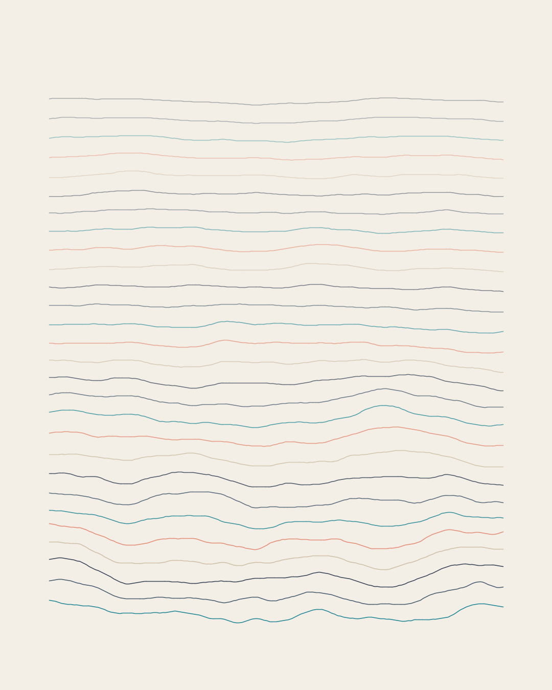

# Processing Sketches

A home for creative coding experiments by **Studio Godi L'onda**, made with [Processing 4](https://processing.org/download).



## Getting started

1. Download and install [Processing 4](https://processing.org/download).
2. Clone this repository.
3. Open any `.pde` file inside `sketches/` in Processing and press **Run**.

## Structure

Every sketch lives in its own folder, and the main `.pde` file shares the folder's name (a Processing requirement).

```
sketches/
  wave_study_01/
    wave_study_01.pde   the sketch
    preview.png         a still for this README
    data/               optional: images, fonts, SVGs the sketch loads
```

Frames you save while a sketch runs go to its `output/` folder, which git ignores so the repository stays light.

## Sketches

| Sketch | Description |
| --- | --- |
| [wave_study_01](sketches/wave_study_01) | Layered noise waves in a 4:5 portrait format. Keys: `s` save, `r` new seed, `p` pause. |

## History

This repository started life as a fork of the Processing 3 source code (2016 to 2018). That history is kept on the `master` branch and in the git log.
